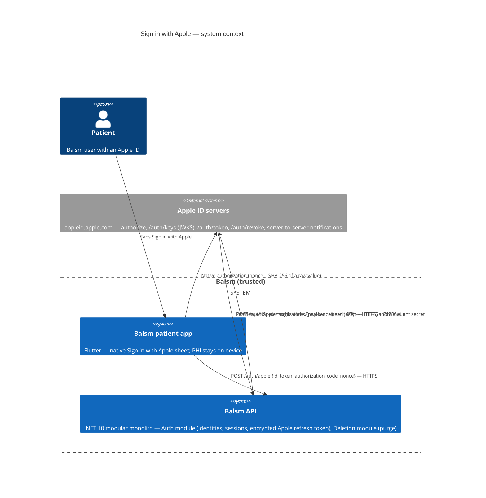

# Sign in with Apple — Level 1: System Context

Patients can sign in with their Apple ID. Owned by **Identity & Access**
(Auth module: `UserIdentity` keyed on Apple's `sub`, `UserRefreshToken`
sessions). Apple is an external identity provider on the far side of a trust
boundary: the API trusts only what Apple has signed, and keeps Apple's refresh
token (encrypted) solely so account deletion can revoke the grant.

Off by default: every Apple endpoint answers `404` while
`SocialSignIn:Enabled` is false.

## Trust boundary and failure modes

- **Inbound from the app:** the ID token must verify against Apple's JWKS
  (RS256 only, issuer `https://appleid.apple.com`, audience `Apple:ClientId`, unexpired),
  and its `nonce` claim must equal the SHA-256 hex of the raw nonce the app
  sends, else `401`. Accounts are keyed on `sub`, never on the email.
- **Outbound to Apple:** the authorization code is exchanged for a refresh
  token, stored AES-256-GCM encrypted. A failed exchange is logged (user id
  only) and **does not fail sign-in**.
- **Inbound from Apple:** `/auth/apple/notifications` is anonymous because
  Apple cannot present a Balsm credential; the signed JWT is the
  authentication: an RS256 signature by Apple's JWKS, issuer
  `https://appleid.apple.com`, audience `Apple:ClientId`, and an `iat` within
  the last 7 days (Apple's retry window) and not in the future — the token
  carries no `exp`, so `iat` is what bounds a replay. Validation failure →
  `400`. A valid payload → `200`, even for
  an unknown `sub` or event type (Apple retries any non-2xx). A revoke event
  older than the user's latest Apple sign-in is ignored: that sign-in
  re-granted consent.
- **Deletion:** the purge revokes the Apple grant, then erases auth data. A
  failed revoke is recorded and the purge continues; the account is kept for
  retry only when the auth erase fails.
- **Never logged or sent to telemetry:** ID tokens, notification payloads,
  authorization codes, refresh tokens, `sub`, email. Logs carry `UserId` and
  event type only; debug body logging redacts `id_token`,
  `authorization_code`, `nonce` and `payload`.
- **Never automatic:** an Apple event never deletes the Balsm account or
  on-device data — deleting a health account is the patient's own action.
