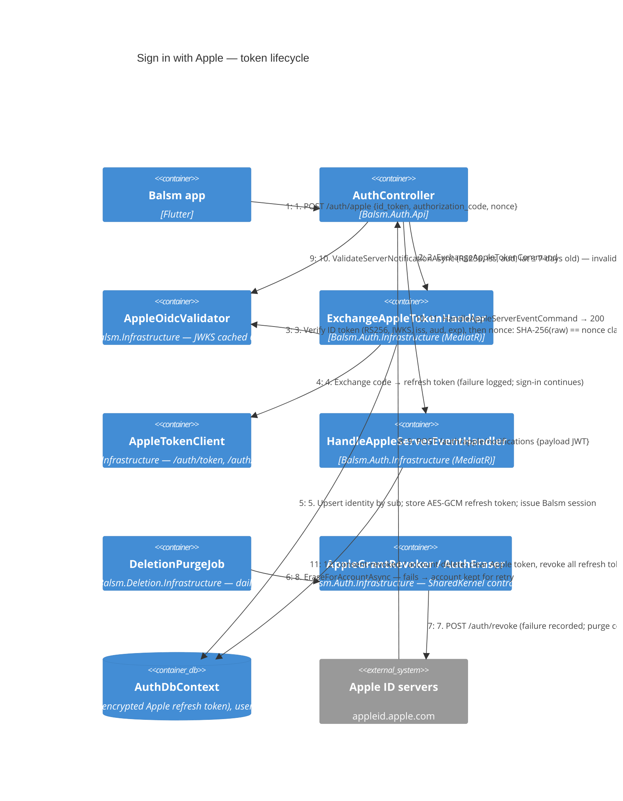

# Sign in with Apple — Level 4: Dynamic (Apple token lifecycle)

The life of an Apple grant inside Balsm: captured at sign-in, revoked at
account purge, and cut off when Apple tells us the user withdrew. All three
paths run in the Auth module (`AuthDbContext`); the purge is driven by the
Deletion module through SharedKernel contracts (`IAppleGrantRevoker`,
`IAccountAuthEraser`), never by a cross-module project reference.

## Failure modes

| Step | Failure | Result |
|---|---|---|
| 3 | ID token invalid, nonce missing or mismatched | `401`; nothing stored |
| 4 | Code exchange fails, Apple down, or client secret not configured | Logged with user id only; sign-in succeeds without a stored refresh token |
| 7 | Apple revoke fails or config missing | Status recorded on the deletion log; purge goes on to the auth erase |
| 8 | Auth erase fails | Account row kept, retried on the next run |
| 10 | Notification JWT missing, not RS256-signed by Apple, wrong audience/issuer, `iat` missing / older than 7 days / in the future, passed `exp`, or malformed `events` | `400` |
| 11–12 | Unknown `sub` or unknown event type | `200`, no-op (logged: event type only) |

`consent-revoked` and `account-delete` sign the user out on every device by
revoking every Balsm refresh token; an access token already issued keeps
working until its 15-minute expiry, after which the app cannot refresh. The
Balsm account and on-device data are kept. The user can sign in again with
Apple, which re-grants consent and stores a fresh refresh token.
