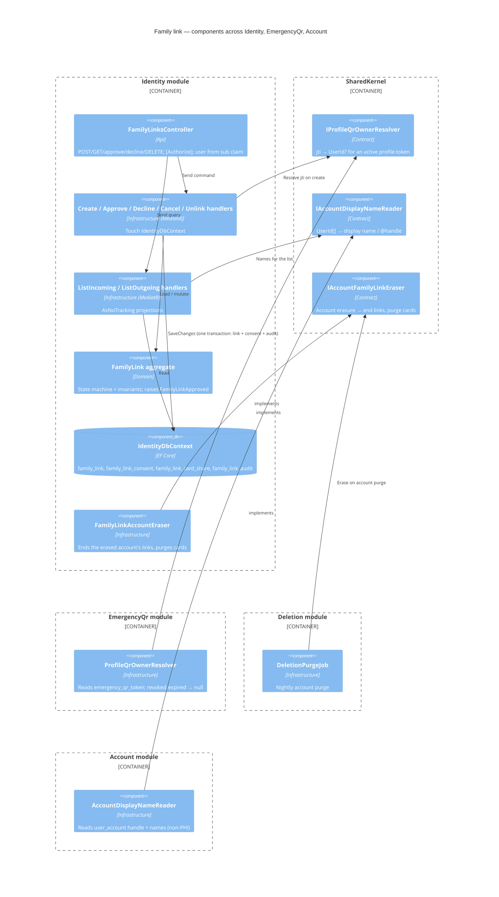

# Family link — Level 3: Components

Three modules take part. None references another's projects: Identity reaches
the others only through **SharedKernel contracts**, implemented in their own
Infrastructure and wired in `Balsm.API/Program.cs`.

