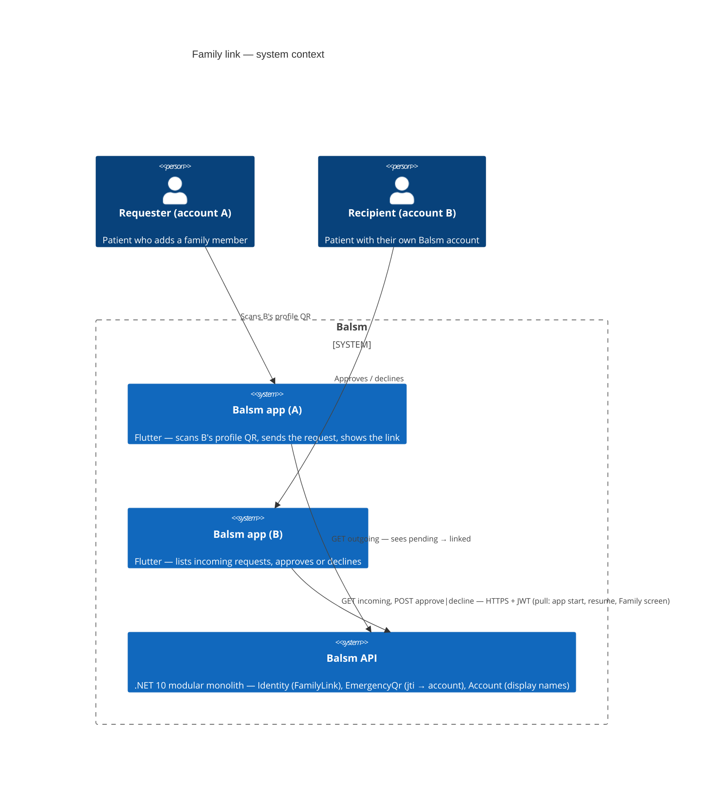

# Family link — Level 1: System Context

Adding a family member who has their own Balsm account: the requester scans the
other person's profile QR, the other person approves in their own app, and the
two accounts are linked. Owned by **Identity & Access** (`Caregiver` /
`Guardianship`, `FamilyLinkStatus: pending → linked`; Balsm-Core
`architecture/bounded-contexts/identity-access.md` §Family linking).

**What a link shares:** the link itself (relation label, status, dates), each side's display name / @handle, and — only if its owner opts in — an **end-to-end-encrypted emergency card** sealed for the other person's device key (see `dynamic-emergency-share.md`).
The server never sees health data in readable form: PHI stays on each person's
device, and the shared card is ciphertext only the viewer's device can open.

## Trust boundary and failure modes

- **Auth:** every endpoint except `/identity/health` requires the patient JWT. Who
  acts is always the `sub` claim, never a body field.
- **jti is a request handle, not an identity.** The server resolves it to account B
  through a SharedKernel contract implemented by EmergencyQr. Unknown, revoked and
  expired tokens answer the same `404` — a scanner can't probe which tokens exist.
  Once a link exists it binds to the two account ids, so B rotating or revoking
  the QR doesn't break it.
- **IDOR (threat E10, BLOCKING):** a request is visible only to its two parties;
  anyone else gets `404`. Approve/decline only by the recipient; cancel only by the
  requester while pending; unlink by either side once linked.
- **Consent both ways:** creating the request is A's consent; approving writes B's
  consent record. Every transition is audited (actor, time, from → to, correlation id).
- **No push:** the API has no server → app channel. B learns of a request by pulling
  (app start/resume, opening Family). Push is out of scope.
- **Abuse:** rate limit on create per account; self-link refused; one open request
  or link per pair.
