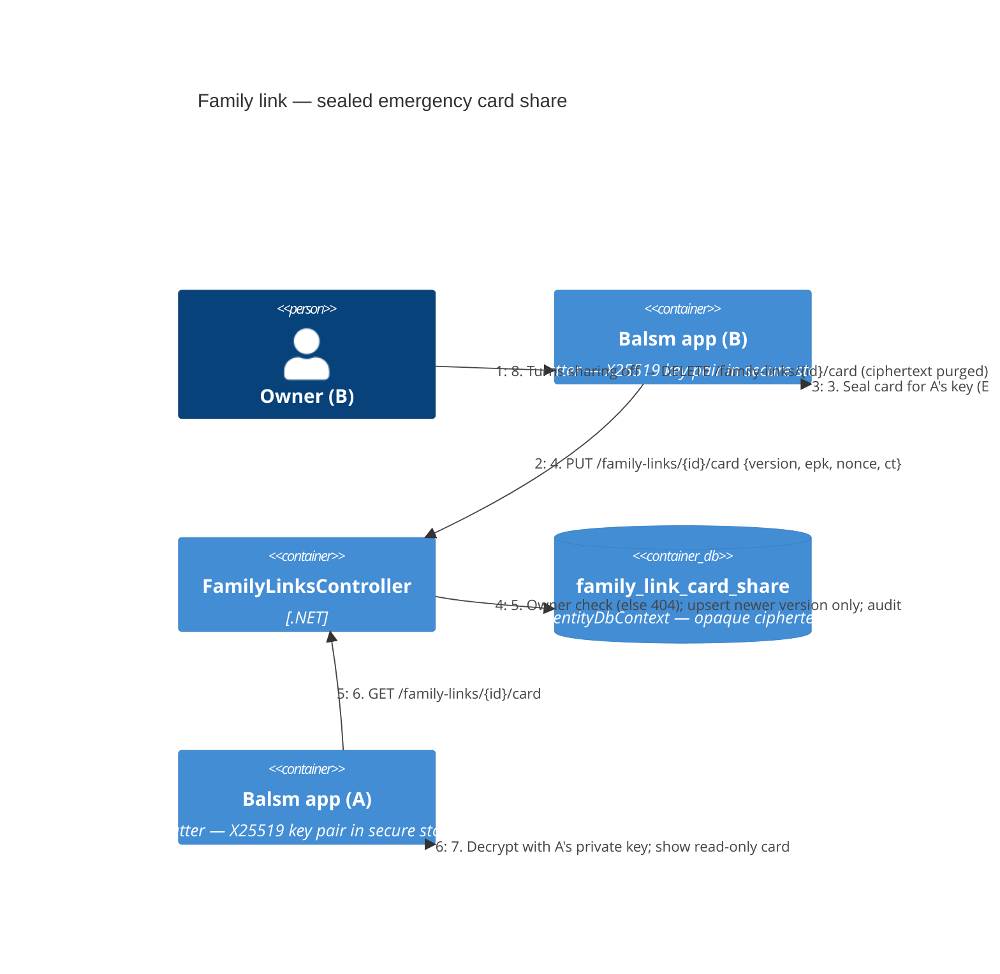

# Family link — Level 4: Dynamic (sealed emergency card share)

A linked member's **emergency card** (blood type, allergies, conditions,
emergency contacts, name, date of birth) is shown in the other person's app only
if its owner opts in, and only as ciphertext the server cannot read.

- Each app holds a device **X25519** key pair (private key in the platform secure
  store, never leaves the device). The public key goes up with the link request
  (A) and with the approval (B).
- The owner seals the card for the viewer: ephemeral X25519 → shared secret →
  HKDF-SHA256 (info `balsm-family-card-v1`, salt = link id) → AES-256-GCM, AAD =
  `link id | owner account id | version`. Server stores `{version, ephemeral
  public key, nonce, ciphertext}` only.
- Opt-in is per link, off by default, revocable at any time. Revoking or unlinking
  **purges the ciphertext** (it's the owner's PHI copy, not a clinical record); the
  audit row stays.
- The owner's app re-seals and uploads a new version whenever the card's fields
  change (or on next app start if offline). The viewer always shows the newest
  version with its "updated" date.
- A viewer key change (new phone) leaves the old ciphertext undecryptable; the
  viewer's app uploads its new public key and the owner's app re-seals on next
  pull. Until then the viewer sees "Ask them to open Balsm to refresh".

## Extra endpoints

| Verb + route | Who | Result |
|---|---|---|
| `PUT /api/v1/family-links/{id}/keys` `{ publicKey }` | either party of the link | `204` · `404` · `422` bad key |
| `GET /api/v1/family-links/{id}` | either party | `200` link incl. the other side's public key |
| `PUT /api/v1/family-links/{id}/card` `{ version, ephemeralPublicKey, nonce, ciphertext }` | the card's owner, link `linked` | `204` · `404` · `409` not linked / stale version · `413` > 16 KB |
| `GET /api/v1/family-links/{id}/card` | the other party | `200` newest sealed card · `404` none shared |
| `DELETE /api/v1/family-links/{id}/card` | the card's owner | `204` (purges ciphertext) |

Both directions are independent: A may share with B and B with A.

## Threats addressed

Server compromise yields only ciphertext (no key on the server). Wrong-recipient /
replay: AAD binds link, owner and version; the server refuses older versions.
IDOR (E10): every route 404s for non-parties. Size cap 16 KB. Telemetry never
carries card fields (existing allowlist).
