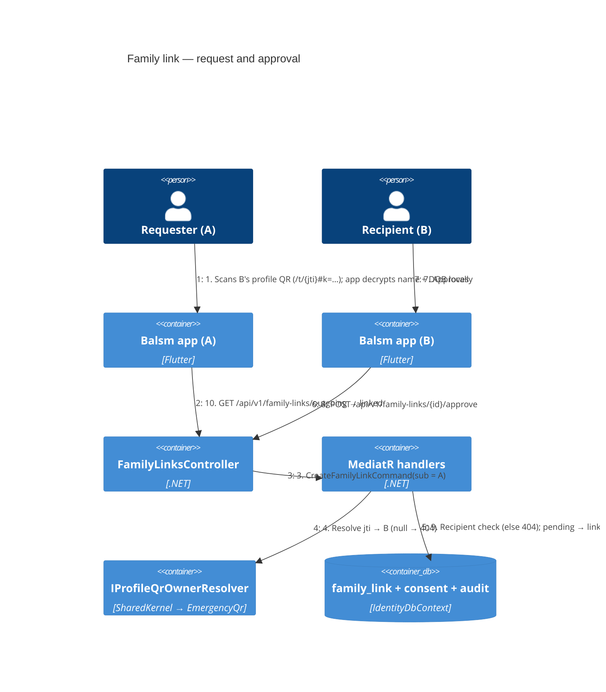

# Family link — Level 4: Dynamic (scan → request → approve)

## API (Identity module, `/api/v1/family-links`)

| Verb + route | Who | Result |
|---|---|---|
| `POST /api/v1/family-links` `{ id, jti, relation }` | requester | `201` pending · `200` same id replayed (idempotent on client id) · `404` unknown/revoked/expired jti · `409` self-link or open request/link for the pair · `422` relation invalid · `429` rate limit |
| `GET /api/v1/family-links/incoming?status=pending` | recipient | `200` paged list: id, requester display name/@handle, relation, createdAt |
| `GET /api/v1/family-links/outgoing` | requester | `200` paged list: id, recipient display name/@handle (after approval only), relation, status, dates |
| `POST /api/v1/family-links/{id}/approve` | recipient | `200` linked · `404` not theirs · `409` not pending |
| `POST /api/v1/family-links/{id}/decline` | recipient | `200` declined · `404` · `409` |
| `DELETE /api/v1/family-links/{id}` | requester (pending → cancelled) or either side (linked → unlinked) | `204` · `404` |
| `GET /identity/health` | anonymous | liveness (already required per module) |

Statuses: `pending → linked | declined | cancelled`, `linked → unlinked`. Rows are
never hard-deleted. The recipient's name is not shown to the requester until
approval — before that, the requester sees only what their own scan showed them,
kept on their own device.

## App side

- `packages/balsm_api`: `FamilyLinksApi` + dio impl + DTOs; core `Provider<FamilyLinksApi>`.
- New module `modules/family_link` (context **Identity & Access**, plane cross-plane):
  replaces the shell's `FamilyMemberPreview` / `FamilyLinkRequest` preview.
- Mother & Child "Add family member" sheet gets back its **Scan their QR code** row;
  incoming requests show in the Family screen and the profile picker with a badge;
  a linked member appears in Family as **Read-only** (design `m.readOnly`) with
  name, relation and — when they share it — their sealed emergency card
  (`dynamic-emergency-share.md`); no other health tiles.
- Behind a new flag `family_link` (fallback **off** — it sends data to the server).

## Tests

Unit (aggregate transitions, every invariant), integration per endpoint incl. an
IDOR test (third account gets 404 on every route), E2E A-requests/B-approves over
HTTP, app widget + API-client tests. Insomnia `docs/api/insomnia/identity.yaml`
(new) and OpenAPI `docs/api/openapi/v1/identity.json` regenerated.
