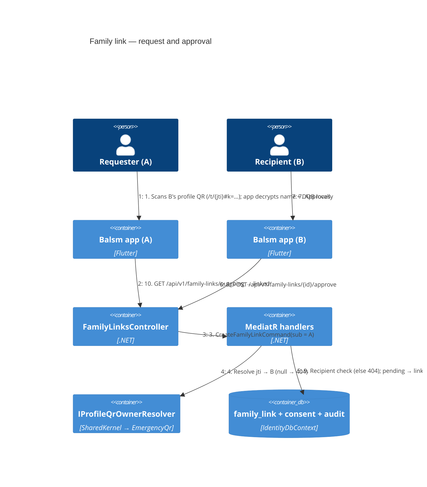

# Family link — Level 4: Dynamic (scan → request → approve)



## API (Identity module, `/api/v1/family-links`)

| Verb + route | Who | Result |
|---|---|---|
| `POST /api/v1/family-links` `{ id, jti, relation, public_key? }` | requester | `201` pending · `200` same id replayed (idempotent on client id) · `404` unknown/revoked/expired jti (and an id owned by another requester) · `409` `FamilyLink.SelfLink` / `FamilyLink.AlreadyExists` (open request or link for the pair, either direction) · `422` relation / id / key invalid · `429` rate limit (20 per account per hour) |
| `GET /api/v1/family-links/incoming?status=pending&page=1&page_size=20` | recipient | `200` paged list of link objects (requester's name/@handle shown) |
| `GET /api/v1/family-links/outgoing?status=&page=&page_size=` | requester | `200` paged list of link objects (recipient's name/@handle/account id only after approval) |
| `GET /api/v1/family-links/{id}` | either party | `200` link object · `404` |
| `POST /api/v1/family-links/{id}/approve` `{ public_key? }` (body optional) | recipient | `200` linked · `404` not theirs · `409` not pending · `422` bad key |
| `POST /api/v1/family-links/{id}/decline` (no body) | recipient | `200` declined · `404` · `409` |
| `DELETE /api/v1/family-links/{id}` | requester (pending → cancelled) or either side (linked → unlinked, both cards purged) | `204` (also on an already-ended link) · `404` · `409` `FamilyLink.RecipientMustDecline` when the recipient tries to cancel a pending request |
| `GET /identity/health` | anonymous | liveness (already required per module) |

### Wire contract (implemented)

snake_case JSON in the `{ "data": … }` envelope; statuses and directions lowercase.
`relation` ∈ `son | daughter | mother | father | spouse | neighbour | friend | other`.
Byte fields (`public_key`, card fields) are standard base64 with padding.

**Link object** (POST create/approve/decline, `GET /{id}`, each list item):

```json
{
  "id": "uuid", "relation": "son", "status": "pending|linked|declined|cancelled|unlinked",
  "direction": "outgoing|incoming",
  "created_at": "iso", "updated_at": "iso|null",
  "other_account_id": "uuid|null",
  "other_display_name": "string|null", "other_handle": "string|null",
  "other_public_key": "base64|null",
  "card_shared_by_me": false, "card_shared_with_me": false,
  "own_public_key": "base64|null", "my_card_version": "int64|null", "their_card_version": "int64|null",
  "responded_at": "iso|null", "linked_at": "iso|null", "ended_at": "iso|null"
}
```

Reveal rules: `other_display_name` / `other_handle` are shown to the recipient
always and to the requester only once linked; `other_account_id` only once linked
(both sides — the viewer needs it for the card AAD); `other_public_key` and
`card_shared_with_me` only while linked. The last six fields are additive extras.

**Lists:** `{ "data": { "items": [link], "page", "page_size", "total_count", "has_next_page" } }`.

**Errors:** `{ "error": { "code", "message", "correlation_id", "fields" } }`; `fields`
(`[{ field, code, message }]`, snake_case field names) only on a 422 `ValidationFailed`.
Codes: `FamilyLink.NotFound`, `.SelfLink`, `.AlreadyExists`, `.NotPending`, `.NotLinked`,
`.RecipientMustDecline`, `.Ended`, `.ConcurrentUpdate` (optimistic-concurrency loss — retry),
`.StaleCardVersion`, `.CardTooLarge`, `.InvalidRelation`, `.InvalidId`, `.InvalidPublicKey`,
`.InvalidCard`, `RateLimitExceeded`.

**Storage:** the family-link tables live in `IdentityDbContext` (schema `identity`,
`Database` connection — the same Postgres as `CloudDatabase` in the cloud deploy):
`family_link`, `family_link_consent`, `family_link_card_share`, `family_link_audit`.
SQLite migrations in `Balsm.Identity.Infrastructure`, Npgsql in
`Balsm.Identity.Infrastructure.Migrations.Npgsql` (the module's existing layout).

**Account deletion:** the nightly purge calls `IAccountFamilyLinkEraser` (SharedKernel,
implemented by Identity) — the erased account's pending requests are cancelled/declined,
active links unlinked, and every sealed card on them purged.

Statuses: `pending → linked | declined | cancelled`, `linked → unlinked`. Rows are
never hard-deleted. The recipient's name is not shown to the requester until
approval — before that, the requester sees only what their own scan showed them,
kept on their own device.

## App side

- `packages/balsm_api`: `FamilyLinksApi` + dio impl + DTOs; core `Provider<FamilyLinksApi>`.
- New module `modules/family_link` (context **Identity & Access**, plane cross-plane):
  replaces the shell's `FamilyMemberPreview` / `FamilyLinkRequest` preview.
- Mother & Child "Add family member" sheet gets back its **Scan their QR code** row;
  incoming requests show in the Family screen and the profile picker with a badge;
  a linked member appears in Family as **Read-only** (design `m.readOnly`) with
  name, relation and — when they share it — their sealed emergency card
  (`dynamic-emergency-share.md`); no other health tiles.
- Behind a new flag `family_link` (fallback **off** — it sends data to the server).

## Tests

Unit (aggregate transitions, every invariant), integration per endpoint incl. an
IDOR test (third account gets 404 on every route), E2E A-requests/B-approves over
HTTP, app widget + API-client tests. Insomnia `docs/api/insomnia/identity.yaml`
(new) and OpenAPI `docs/api/openapi/v1/identity.json` regenerated.
