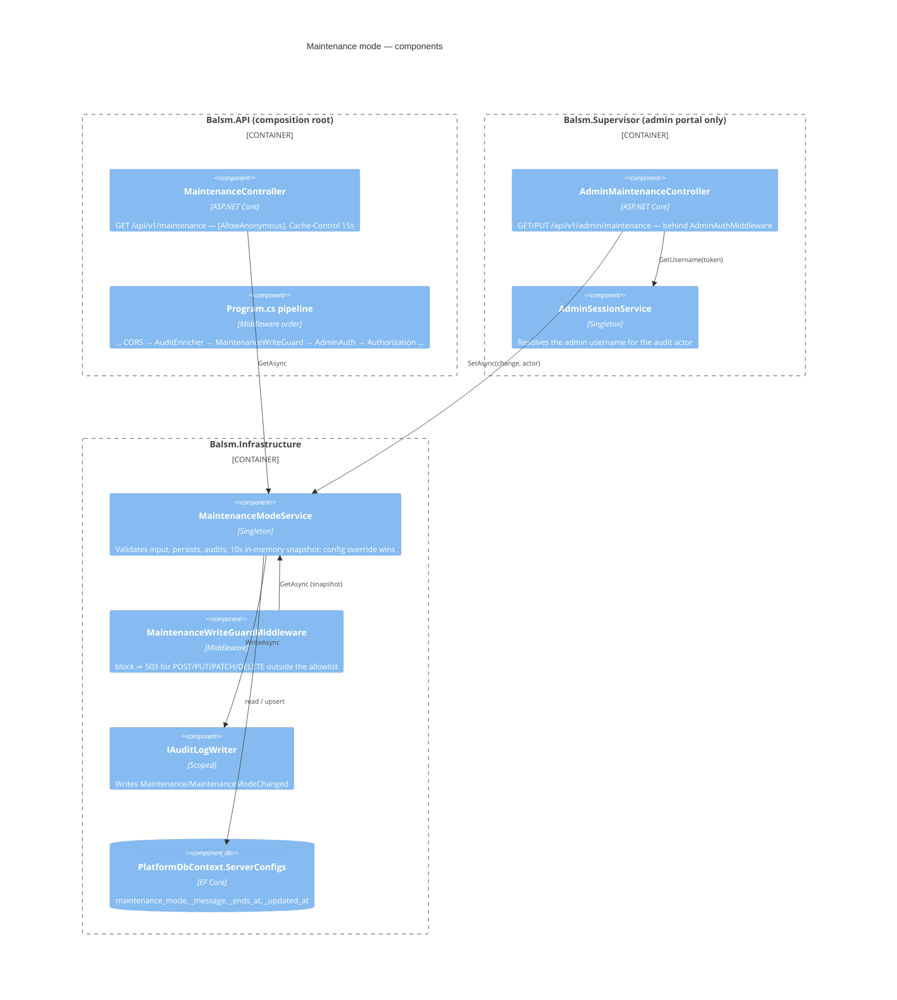

# Maintenance mode — Level 3: Component

Maintenance is platform plumbing, not a bounded context: it lives in the shared
`Balsm.Infrastructure` (state + write guard) with one host controller and one
Supervisor controller. No module project is touched and no module references
another. State is three rows in the existing `PlatformDbContext.ServerConfigs`
key/value table — no migration.

Write-guard allowlist (block mode): `/api/v1/admin/*` (so the admin can switch
it off), `/api/v1/federation/*` and `/connect` (server-to-server), `/auth/refresh`
and `/auth/sign-out` (keep sessions alive / let a patient sign out). All `GET`s
pass, so health probes, `/status`, the flag itself and the public emergency-QR
resolve stay up.
