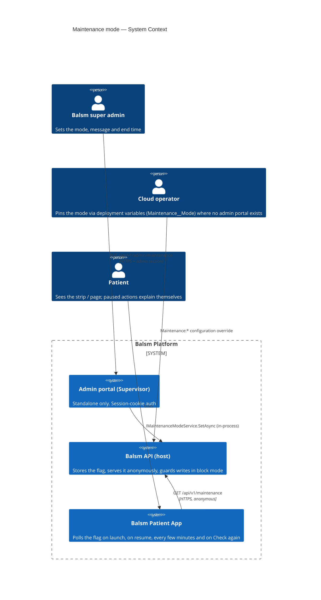

# Maintenance mode — Level 1: System Context

A Balsm super admin can put the platform into maintenance:

- `off` — normal operation.
- `readonly` — the patient app stays readable (records, medicines, emergency
  card) but pauses logging, adding, syncing, sharing, sign-in and new accounts.
  Enforced **in the app**; the API keeps accepting writes so older app builds
  keep working against a healthy server.
- `block` — the app shows a full-screen page; only the on-device emergency card
  and the country emergency number stay reachable. The API refuses
  non-essential writes with `503` + `Retry-After`.

An optional admin message and announced end time travel with the mode. The flag
holds no PHI and no per-user data.

Failure modes: if the read fails (offline, timeout, 5xx) the app treats the
mode as **unknown** and never blocks itself; the last known mode is kept only
while it is fresh.
