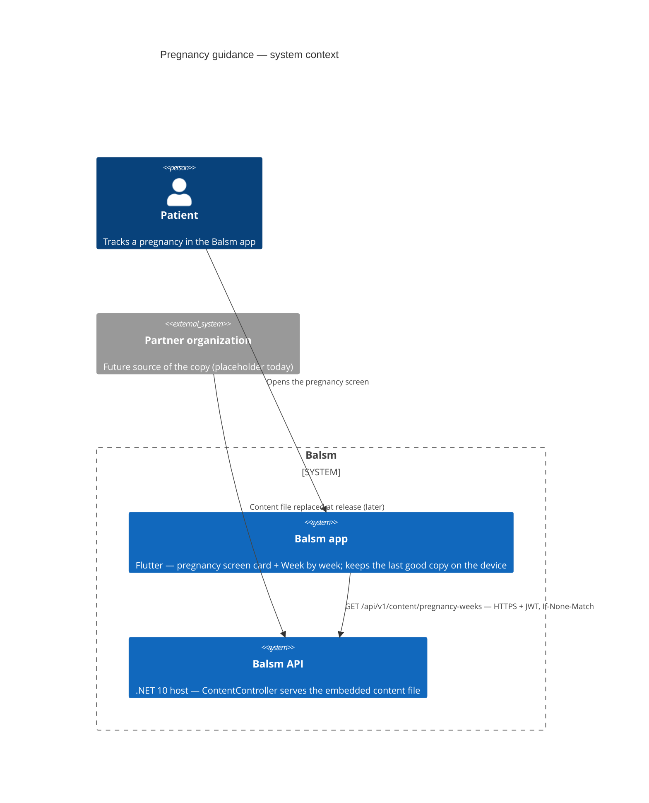

# Pregnancy guidance — Level 1: System Context

Week-by-week pregnancy guidance (Phase 003b, Mother & Child): a short card on
the app's pregnancy screen and a "Week by week" list of weeks 4–40. The copy is
**general information, the same for every patient** — never patient data — so
it is platform content served by the `Balsm.API` host, not a bounded-context
module. For now it is placeholder copy in a static JSON file embedded in the
API assembly (`src/Balsm.API/Content/pregnancy-weeks.v1.json`); partner
content later replaces that file with the same shape and a new `version`, and
reaches the app without a client change.

## Trust boundary and failure modes

- **Auth:** `[Authorize]` — any valid patient access token, no further
  permission (the content is identical for everyone). Anonymous → `401`.
  Device-only accounts hold no token: the app's auth interceptor refuses the
  request on the device as if offline, so nothing leaves the phone and they
  see no guidance until the account goes online.
- **No PHI either way:** the request carries only the session token; the
  response is general copy. The app does not send the pregnancy week — it
  downloads every week and picks one locally, so the server never learns how
  far along anyone is.
- **Caching:** strong `ETag` (SHA-256 of the content file) and
  `Cache-Control: private, max-age=86400` (`private` because the endpoint is
  authenticated: a shared cache must not answer for it). `If-None-Match` with
  the current tag → `304`, no body.
- **Failure:** the app shows the copy it last stored; with none stored and the
  server unreachable it leaves the card out — no error.
- **Bad content:** the file is validated when first loaded (version present,
  weeks 4–40 once each, ascending, every language present, no unknown fields);
  a malformed file fails loudly (500) rather than serving partial guidance, and
  a unit test loads the shipped file so it never reaches a release.
