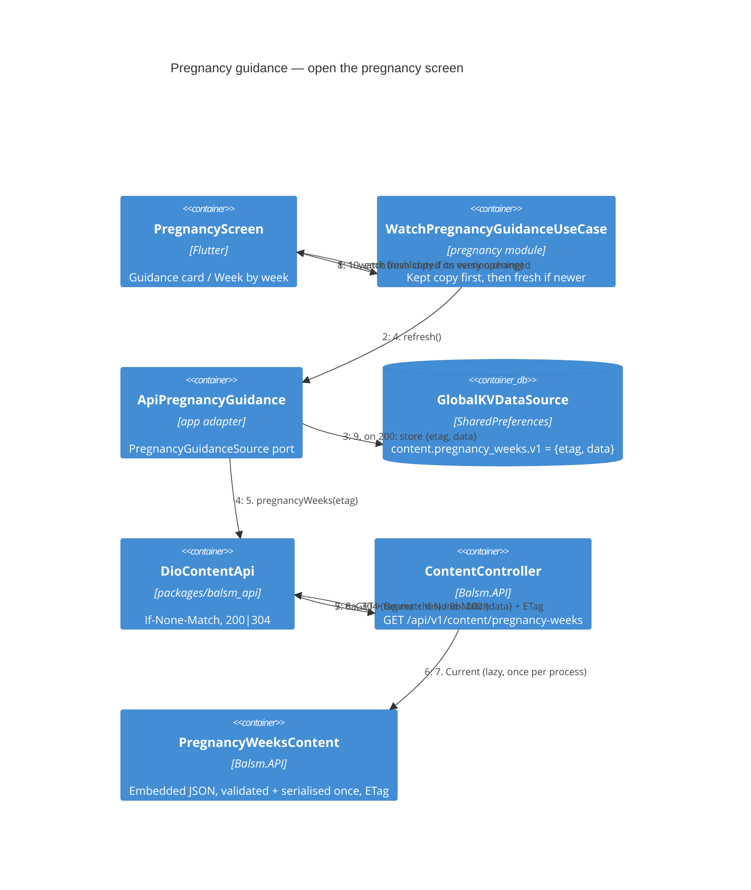

# Pregnancy guidance — Level 4: Dynamic (fetch and revalidate)

No module, MediatR handler, repository or DbContext is involved: the content is
a static file embedded in `Balsm.API` and loaded once per process.

Failure paths: `401`, offline, timeout, malformed body → the adapter returns the
kept copy (or null); the card is hidden when there is nothing at all.
