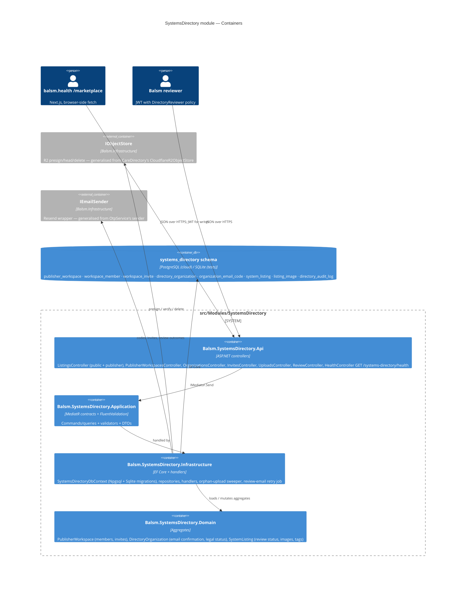

# Systems Directory — Level 2: Container

Standard four-project module. Handlers that touch the DbContext live in
Infrastructure (repo rule). No reference to any other module: sign-in comes from
the JWT the Auth module issues (user id claim); the object store and email
sender come from `Balsm.Infrastructure`.

## Endpoints (proposed)

All under `/api/v1`. Envelope `{ data, error }`, `ProblemDetails` on 4xx,
`Idempotency-Key` on creates, cursor pagination on lists.

| Method + route | Auth | Purpose |
|---|---|---|
| `GET /systems` | anonymous | Published listings; `q`, `areas[]`, `platforms[]`, `compat[]`, `cursor` |
| `GET /systems/{id}` | anonymous | One published listing |
| `GET /systems/mine` | JWT | Listings of the caller's workspaces, any status |
| `POST /systems` | JWT, editor+ | Submit a listing (→ `pending`) |
| `PATCH /systems/{id}` | JWT, editor+ | Edit (published → back to `pending`) |
| `DELETE /systems/{id}` | JWT, admin+ | Soft-delete |
| `POST /systems/uploads` | JWT, editor+ | Presigned PUT for a listing image (type + size declared) |
| `GET /publisher-workspaces` | JWT | Caller's workspaces with role |
| `POST /publisher-workspaces` | JWT | Create (caller becomes owner); handle check |
| `PATCH /publisher-workspaces/{id}` | JWT, admin+ | Rename |
| `GET /publisher-workspaces/{id}/members` | JWT, member | Members + pending invites |
| `PATCH /publisher-workspaces/{id}/members/{userId}` | JWT, admin+ | Change role |
| `DELETE /publisher-workspaces/{id}/members/{userId}` | JWT, admin+ | Remove (not the owner) |
| `POST /publisher-workspaces/{id}/invites` | JWT, admin+ | Invite email + role (sends email) |
| `DELETE /publisher-workspaces/{id}/invites/{inviteId}` | JWT, admin+ | Cancel invite |
| `GET /publisher-invites` | JWT | Invites addressed to the caller's email |
| `POST /publisher-invites/{id}/accept` · `/decline` | JWT | Join / decline |
| `POST /publisher-workspaces/{id}/organizations` | JWT, admin+ | Add organisation |
| `PATCH /directory-organizations/{id}` | JWT, admin+ | Edit |
| `POST /directory-organizations/{id}/email-confirmation` | JWT, admin+ | Send 6-digit code to the work email |
| `POST /directory-organizations/{id}/email-confirmation/verify` | JWT, admin+ | Check code |
| `POST /directory-organizations/{id}/legal-verification` | JWT, admin+ | Registry no. + tax no. + document key (presigned via `/uploads`, private bucket) → `pending` |
| `GET /admin/systems-directory/reviews` | DirectoryReviewer | Pending listings + verification requests |
| `POST /admin/systems/{id}/approve` · `/reject` | DirectoryReviewer | Listing review (reject needs a note) |
| `POST /admin/directory-organizations/{id}/verify` · `/reject-verification` | DirectoryReviewer | Legal verification |
| `GET /admin/directory-organizations/{id}/document` | DirectoryReviewer | 60-second presigned GET of the private document |

The facility waitlist (`انضم إلى قائمة الانتظار`) is **not** in this module: it
keeps using the website's existing `/api/waitlist` (Supabase) with
`source: "marketplace"`, like the Providers form.

## Data notes

- PostgreSQL schema `systems_directory`; ids UUID v7; every table has
  `created_at`, `updated_at`, `is_deleted`, `deleted_at`; optimistic concurrency
  via `xmin` row version on listings and workspaces.
- Indexes: `system_listing(status, created_at)`, GIN on tag arrays,
  `publisher_workspace(handle)` unique, `workspace_member(user_id)`,
  `workspace_invite(lower(email))`.
- Audit: `directory_audit_log` row per membership/role/invite change, org
  verification and listing review — actor, entity, previous → new value, time.
- Email confirmation codes: hashed, 10-minute expiry, 5 attempts, 3 sends/hour.

## Open decisions (need your call before code)

1. **Reviewer identity.** The cloud API has no admin role today (the admin panel
   is Standalone-only). Proposal: a `DirectoryReviewer` policy backed by a
   config allowlist of Balsm account ids (`SystemsDirectory:ReviewerUserIds`).
   Alternative: add a role claim to the Auth module's JWT.
2. **Shared plumbing.** `CloudflareR2ObjectStore` lives in the CareDirectory
   module and the Resend sender inside `OtpService`. Both move to
   `Balsm.Infrastructure` behind `IObjectStore` / `IEmailSender` (small refactor
   of those two call sites) so this module doesn't reference CareDirectory.
3. **Seed data.** The website shows three sample listings. Proposal: drop them
   once the API is live (an empty directory with a "list your system" prompt),
   rather than seeding fake companies into production.
