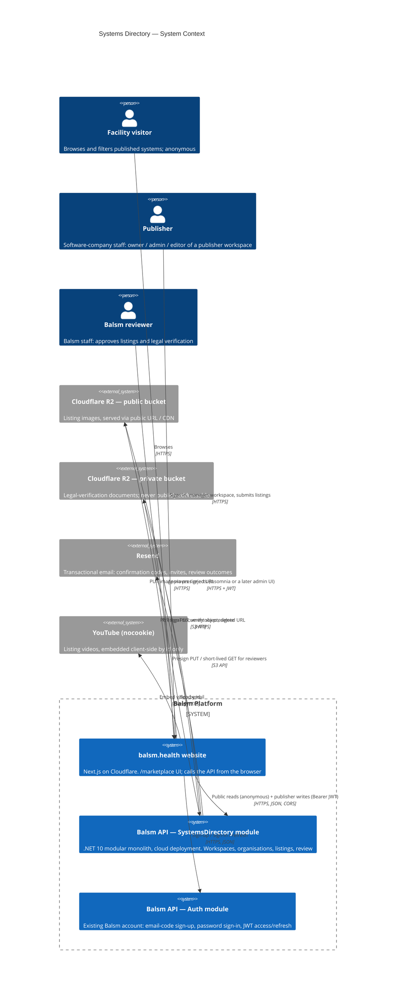

# Systems Directory — Level 1: System Context

The website's Marketplace page (`balsm.health/marketplace`, سوق الأنظمة) is a
public directory of health **software** systems. Software companies sign in
with their Balsm account, set up a publisher workspace, add their organisations,
and submit listings; Balsm staff review listings and legal verification before
anything shows publicly. Facilities browse anonymously.

The UI is already built and currently keeps its state in the visitor's browser
(`website/src/components/cloud/marketplace/store.ts`). This module replaces that
with server-side persistence.

Bounded context: **Systems Directory** (Platform plane, Supporting, no PHI) —
`Balsm-Core/architecture/bounded-contexts/systems-directory.md`, added by
constitution v1.9.0. Not the P022 add-on Marketplace and not the Provider
Directory.

## Trust boundaries

| Boundary | Control |
|---|---|
| Browser → API (public reads) | Anonymous `GET` of **published** listings only; rate-limited per IP like the other anonymous endpoints (`/auth/*`, emergency QR); response cached at the edge. |
| Browser → API (writes) | Bearer JWT from the Auth module; every handler checks workspace role (owner / admin / editor) server-side. CORS allows the website origins via `Cors:AllowedOrigins`. |
| Browser → R2 | Short-lived (5 min) presigned `PUT` scoped to one object key, content type and max length. The API verifies the object (HEAD: size, type) before attaching it to a listing; unattached uploads are swept after 24 h. Keeps 5–10 MB files off the API, whose request body cap is 2 MB. |
| Reviewer → API | `DirectoryReviewer` authorization policy (see container.md, open decision). |
| API → Resend / R2 | Credentials from environment (`Resend:*`, `SystemsDirectory:R2:*`); timeouts + circuit breaker; failures surface as retryable errors, never partial state. |

## Failure modes

- **R2 unavailable:** presign fails → `503` with retry hint; nothing is written.
- **Upload never completes / wrong type or size:** listing submit rejects the image key (`422`); orphan swept later.
- **Resend down:** confirmation/invite returns `503`; no code is stored as "sent" so the user can retry. Review-outcome emails are queued and retried by a background job — the decision itself is already committed.
- **Token expired mid-flow:** `401` → website refreshes via `/auth/refresh` and retries once.
