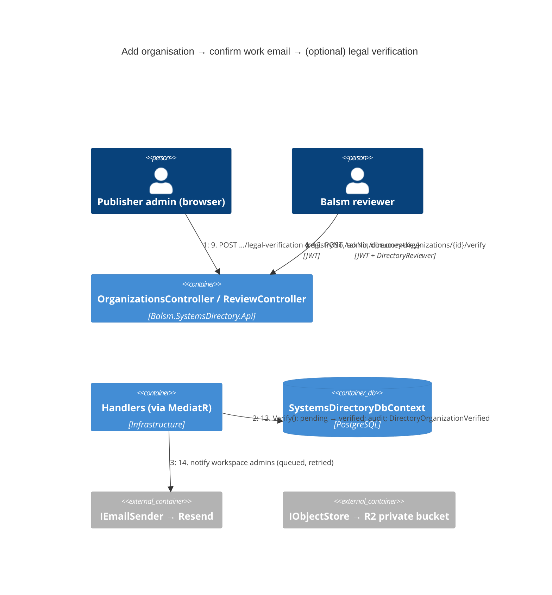

# Systems Directory — Level 4: Dynamic — organisation email confirmation and legal verification

## Failure modes and trust

- Email confirmation is optional for listing (as in the design) but shown on the
  organisation card; legal verification is optional and drives the "Verified"
  badge only.
- The document never leaves the private bucket except through the reviewer's
  60-second presigned GET; the publisher cannot read it back after submitting.
- Wrong code: `422` with remaining attempts; after 5, the code is burned and a
  new one must be sent. Resend failure at step 5: `503`, no code stored as sent.
- Reject verification needs a note; status returns to `unverified` and the
  publisher may resubmit.
