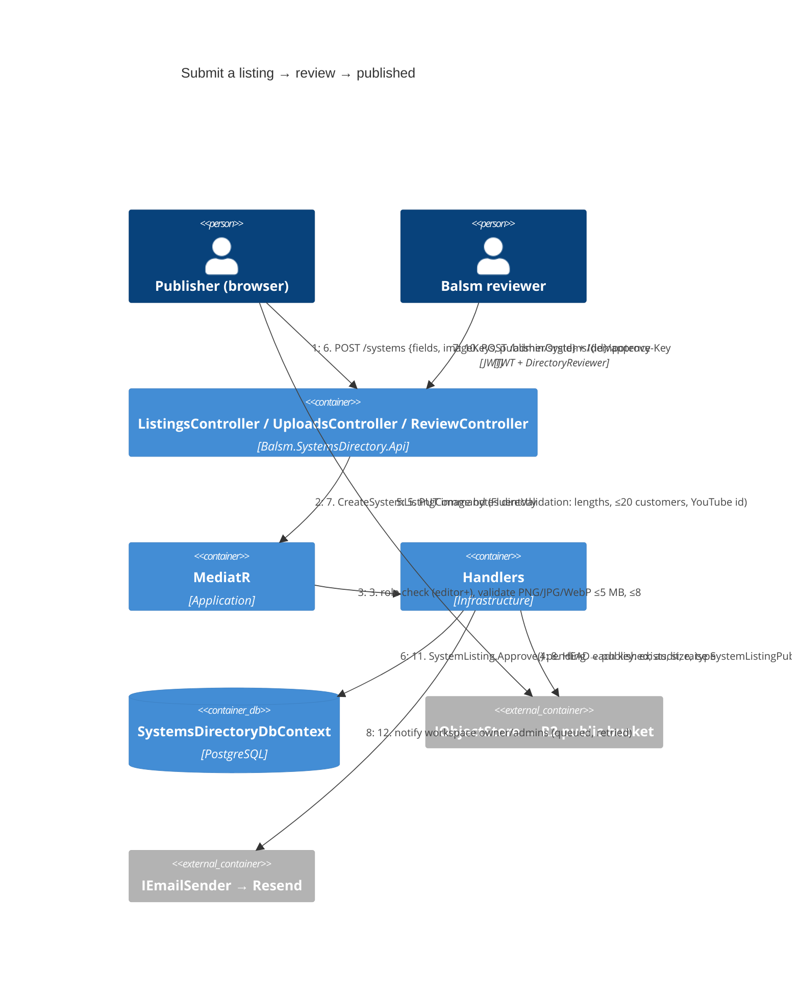

# Systems Directory — Level 4: Dynamic — submit and publish a listing

## Notes

- Step 9 is one transaction. If any image fails the HEAD check the command
  returns `422` listing the bad keys and nothing is written.
- Re-sending step 6 with the same `Idempotency-Key` returns the first result.
- `GET /systems` only ever reads `status = published AND NOT is_deleted`.
- Reject (`/reject` with a required note) moves `pending → rejected`; the
  publisher edits and resubmits, which returns it to `pending`.
- Editing a published listing (`PATCH`) moves it back to `pending`; the last
  published version stays hidden until re-approved (no draft/published split in
  v1 — call out if you want the live version kept visible during review).
